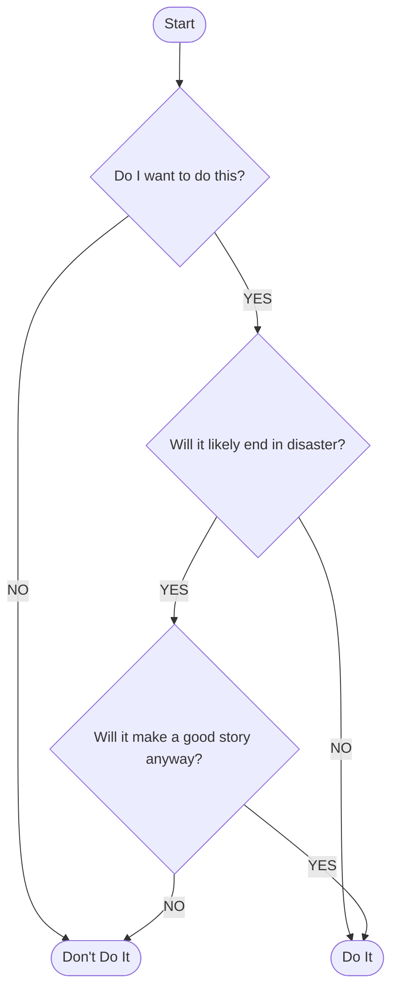
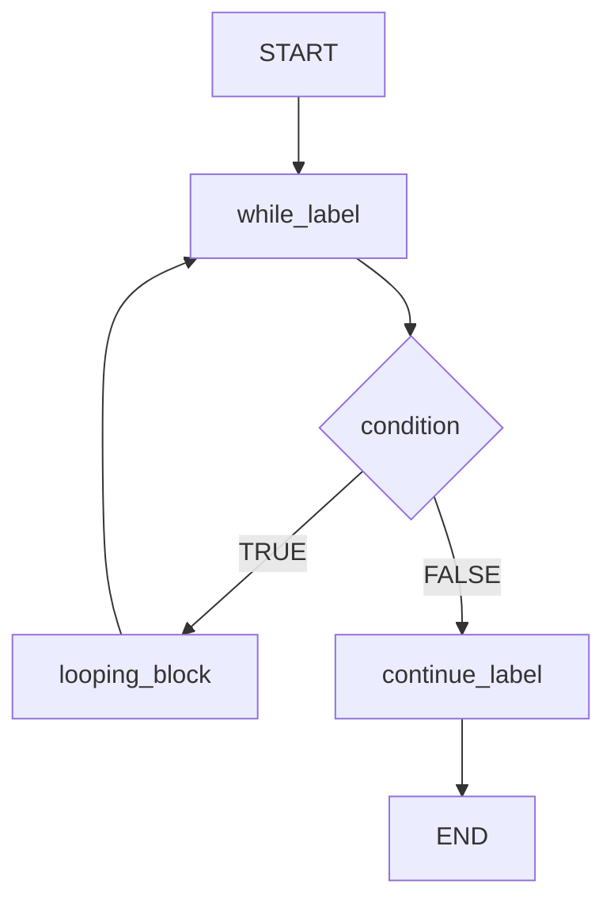

# 02. Понятие за алгоритъм

## Понятие за алгоритъм

**Дефиниция.** **Алгоритъм** е **крайна** последователност от **действия**, които водят до решаване на даден проблем, свързан с:
- обработка на информация (данни);
- чрез изчисления (инструкции/код).

Блок-схема на алгоритъм (по слайда):



## Свойства на алгоритъма

1. Трябва да е коректен.
2. Трябва да съдържа прецизни и добре дефинирани стъпки, които може да се извършат в рамките на точно определено време, както от човек, така и от машина.
3. Последователността на стъпките трябва да е много точно дефинирана; не се допуска двусмислие за това коя да бъде следващата стъпка.
4. Стъпките са краен брой.

**Бел.** В слайдовете в т. 2 е „прецизни и добре дефинирани, които може“, липсва съществителното; трябва да е „прецизни и добре дефинирани стъпки (действия)“. В т. 3 е „трябва да много точно дефинирана“, трябва да е „трябва да е много точно дефинирана“.

## Основни алгоритмични концепции

- Последователност от действия.
- Повторение (цикъл, итерация).
- Логически/условен преход (разклонение).

Трите концепции в една блок-схема (цикъл `while`):



Правоъгълниците (`while_label`, `looping_block`, `continue_label`) са **действие, операция**; ромбът `condition` е **разклонение**; връщането от `looping_block` към `while_label` е **повторение**. Същото, записано с условен преход и `goto`:

```cpp
...
while_label:
if (!condition)
    goto continue_label;
looping_block
goto while_label;
continue_label:
...
```

## Представяне на алгоритъмите

Алгоритъм може да се представи чрез:
- блок-схема;
- псевдокод;
- програмен език.

### Блок схеми

Блок-схемата изобразява стъпките с фигури, свързани със стрелки: начало и край (`START`, `END`), действие (правоъгълник), условие (ромб) с изходи `TRUE` и `FALSE`. Пример е блок-схемата на цикъла от предишния раздел.

### Псевдокод и програмен език (C++)

Един и същ алгоритъм, записан на псевдокод и на C++:

Пример 1: [[02-01-Сума-на-списък-числа]]

---
Източници: `материали/UP_t02_Algorithm.pdf` (слайдове от лекцията, тема 2).
